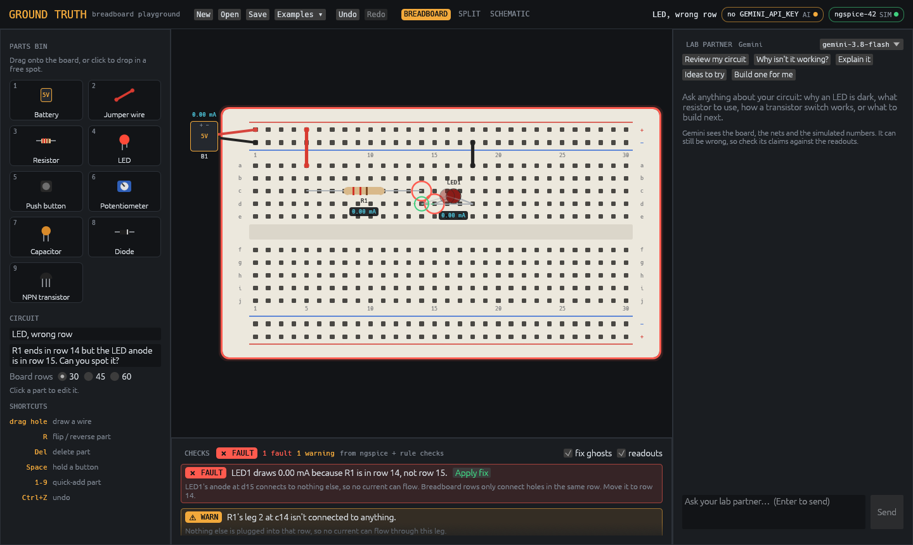
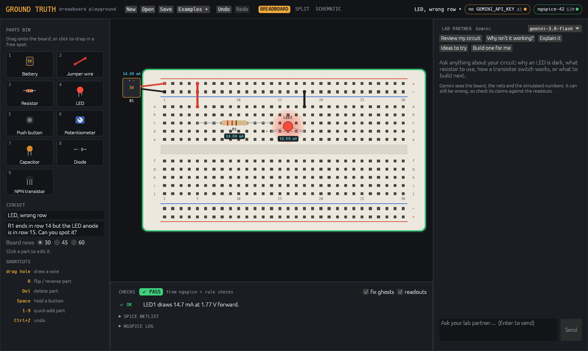
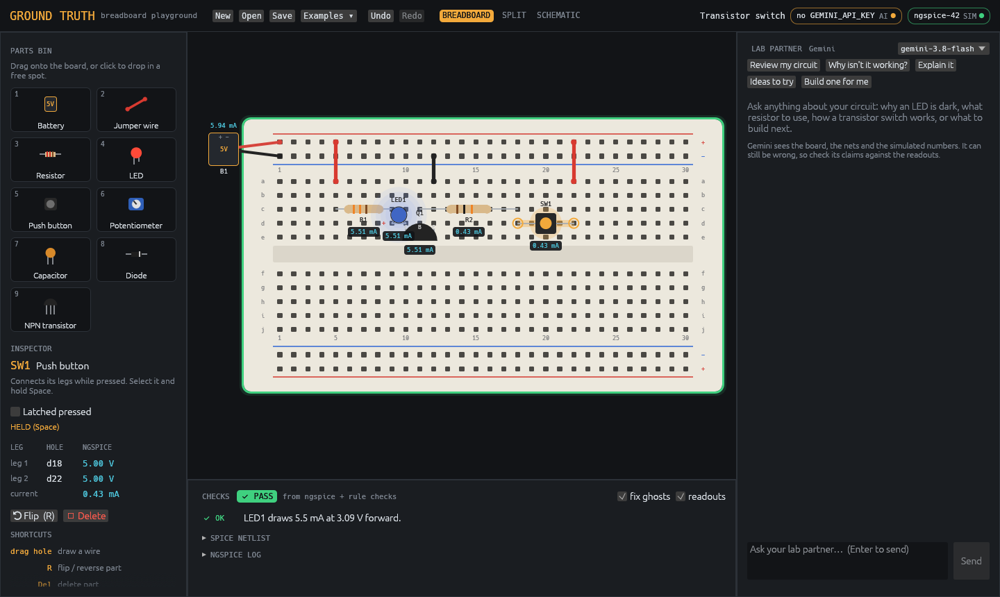
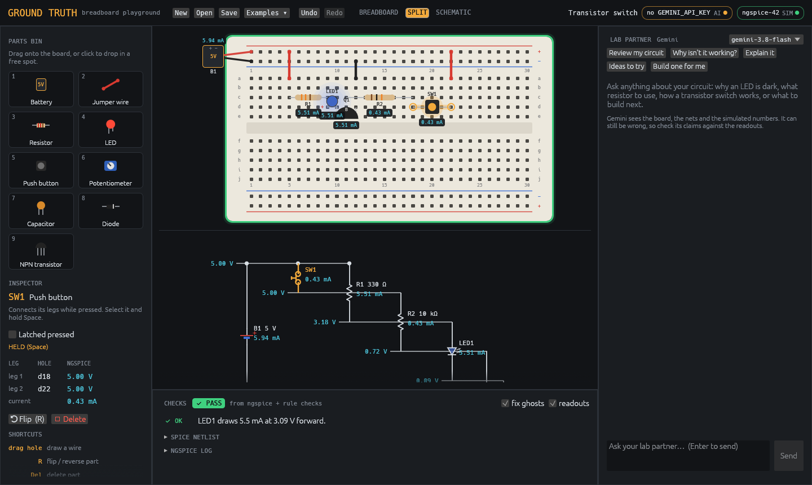
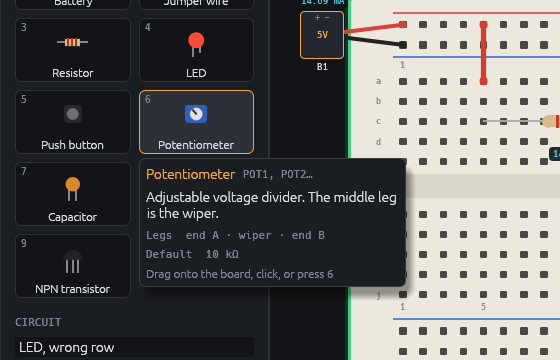

# Ground Truth

A drag-and-drop breadboard playground for learning electronics. Build a circuit on a virtual breadboard, ngspice simulates it live, and a Gemini lab partner explains what's going on and suggests what to try next.

The simulator supplies the numbers; Gemini supplies the teaching. Every voltage and current in the app comes from ngspice, and Gemini's replies are labeled as AI output.



## What it does

**Spot the mistake.** The rule checker reads the simulated numbers and flags faults on the board. Here, the resistor ends in row 14 but the LED's anode sits in row 15, so no current flows. A green ghost shows where the leg should go, and **Apply fix** moves it.



**Watch it work.** Live readouts update on every edit. In the transistor switch, select SW1 and hold Space: a small base current through R2 switches the LED current through Q1.



**See the schematic.** The schematic is generated from the same circuit, stacked by simulated voltage, with selection synced to the breadboard.



**Start from scratch.** Drag a battery, resistor, LED and wires from the parts bin. Hover a part to see its legs, default value and shortcut key.



**Ask the lab partner.** "Review my circuit", "Why isn't it working?", "Explain it" and "Ideas to try" send the circuit, nets, simulation results and rule findings to Gemini. "Build one for me" asks Gemini to propose a circuit that loads onto the board, where ngspice simulates it like any other.

## Running it

You need Rust and [ngspice](https://ngspice.sourceforge.io/) on your PATH.

```sh
cp .env.example .env   # then add your GEMINI_API_KEY
cargo run
```

Open **Examples** for ready-made circuits, or pass one on the command line: `cargo run -- circuits/pot_dimmer.json --split`.

The app works without a Gemini key; only the lab partner is disabled. `GEMINI_MODEL` and `NGSPICE_PATH` in `.env` are optional.

## Tests

```sh
cargo test                                         # needs ngspice for the simulation checks
cargo test gemini_live -- --ignored --nocapture    # live Gemini call, needs GEMINI_API_KEY
```

Every example in `circuits/` has an `expect` block the tests check against the simulation.

## Layout

- `src/circuit.rs`: holes, parts, circuits, SI value parsing
- `src/sim/`: SPICE netlist builder, ngspice runner, rule checks
- `src/assistant.rs`: Gemini lab partner
- `src/ui/`: breadboard editor, schematic, theme
- `src/app.rs`: panels, undo/redo, save/open
- `circuits/`: example circuits
